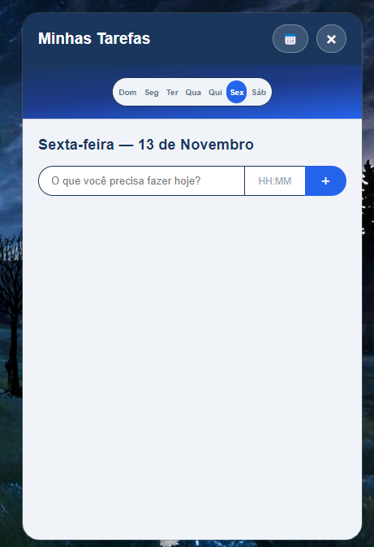
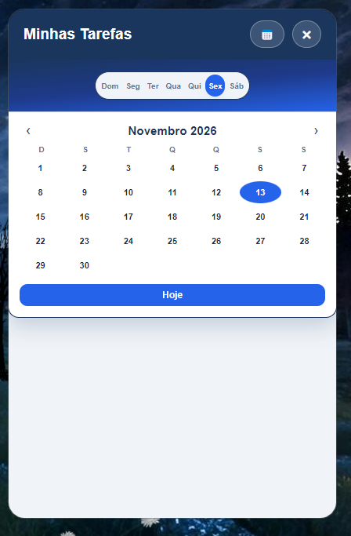
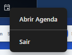
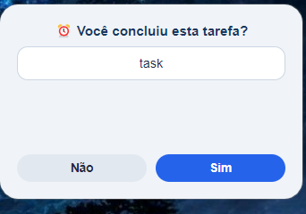

# 🗓️ Desktop Virtual Agenda & To-Do App

> Aplicativo desktop minimalista e moderno desenvolvido com **Electron** e **Node.js**, projetado para gerenciar tarefas diárias com lógica de reset automático, estética de janela sem bordas (*frameless*) e interface altamente personalizável.

---

## 🎯 Sobre o Projeto
O **Minha-Agenda** nasceu da necessidade de ter uma ferramenta de produtividade leve, customizada e integrada ao ambiente de trabalho (Windows), focada em organização diária de alta performance sem as distrações de aplicações web tradicionais baseadas em navegador.

---
## 📸 Demonstração Visual

<p align="center">
  
  
</p>
<p align="center">
  
  
</p>

## 🛠️ Stack Tecnológica
* **Core:** Node.js, JavaScript (ES6+)
* **Framework Desktop:** Electron & `electron-builder`
* **Interface & Estilização:** HTML5, CSS3 Customizado (componentes modernos e design system próprio)
* **Automação (Opcional):** Integração com macros do AutoHotkey para atalhos globais de sistema

---

## ✨ Principais Funcionalidades
* **Reset Diário Dinâmico:** Lógica inteligente em background que gerencia o ciclo de vida das tarefas para o novo dia.
* **Interface Moderna (*Frameless*):** Janela personalizada sem barra de título padrão do SO, proporcionando um design limpo, imersivo e elegante.
* **Persistência Local:** Gerenciamento de estado otimizado para salvar o progresso instantaneamente.
* **Empacotamento Nativo:** Pronto para ser gerado como executável (`.exe`) independente para Windows.

---

## ⚙️ Como Executar o Projeto Localmente

Siga os passos abaixo para clonar e rodar o aplicativo na sua máquina:

1. **Clone o repositório:**
   ```bash
   git clone https://github.com/GuMouzin/Minha-Agenda.git
   cd Minha-Agenda
   ```

2. **Instale as dependências:**
   ```bash
   npm install
   ```

3. **Inicie o aplicativo em modo de desenvolvimento:**
   ```bash
   npm start
   ```

---

## 📦 Como Gerar o Executável (`.exe`)
Para empacotar a aplicação e gerar o instalador/executável utilizando o `electron-builder`:
```bash
npm run build
```

---

## 📂 Estrutura do Projeto
```text
├── src/
│   ├── assets/         # Ícones e elementos visuais
│   ├── index.html      # Interface principal da agenda
│   ├── renderer.js     # Lógica de manipulação do DOM e estado da aplicação
│   └── main.js         # Processo principal do Electron (Main Process)
├── package.json        # Dependências, metadados e scripts de build
└── README.md           # Documentação do projeto
```

---
*Desenvolvido por **Gustavo Mouzin**.*