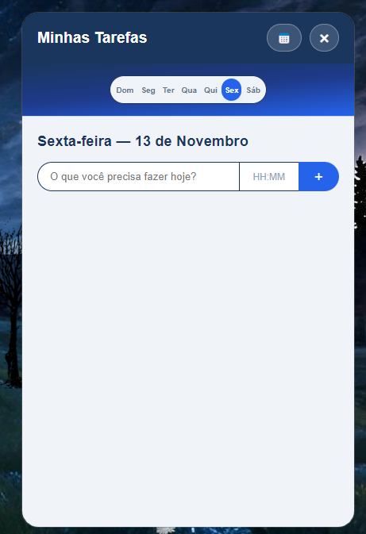
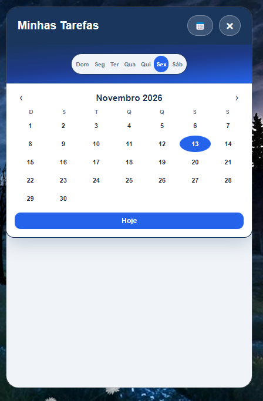
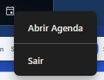
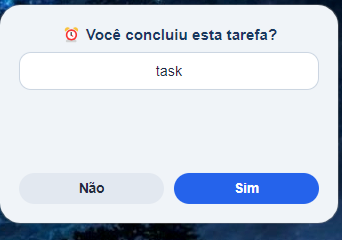

# 🗓️ Minha Agenda — Desktop & Android

> Agenda e lista de tarefas minimalista para **Windows (Electron)** e **Android (Capacitor)**, com **sincronização em tempo real entre os dois** via Firebase: o que você cria no PC aparece no celular e vice-versa.

---

## 🎯 Sobre o Projeto
O **Minha-Agenda** nasceu da necessidade de ter uma ferramenta de produtividade leve, customizada e integrada ao ambiente de trabalho (Windows), focada em organização diária sem as distrações de aplicações web tradicionais. Agora ela também roda no **Android**, com o mesmo código de interface, e os dois lados ficam sincronizados.

---
## 📸 Demonstração Visual

<p align="center">
  
  
</p>
<p align="center">
  
  
</p>

## 🛠️ Stack Tecnológica
* **Core:** Node.js, JavaScript (ES6+)
* **Desktop:** Electron & `electron-builder`
* **Android:** Capacitor, com um plugin nativo em Java para alarmes e notificações
* **Sincronização:** Firebase Authentication (e-mail/senha) + Cloud Firestore com cache offline
* **Build web:** esbuild (empacota o SDK do Firebase em `sync.bundle.js`)
* **Interface & Estilização:** HTML5, CSS3 customizado (componentes modernos e design system próprio)
* **Automação (Opcional):** Integração com macros do AutoHotkey para atalhos globais de sistema

---

## ✨ Principais Funcionalidades
* **Sincronização PC ↔ Android:** cada tarefa é um documento no Firestore; alterações aparecem nos dois aparelhos em tempo real e funcionam **offline** (enviadas ao reconectar). Exclusões não "ressuscitam" tarefas em outro aparelho.
* **Lembretes nos dois sistemas:**
  * **PC:** pop-up *"Você concluiu esta tarefa?"* com beep, 20 min após o horário, repetindo a cada 20 min.
  * **Android:** alarmes exatos do sistema (funcionam com o app fechado e voltam após reiniciar o celular). A notificação aparece em destaque, como uma chamada, com os botões **Sim** e **Não**; tocar nela abre um pop-up Sim/Não, inclusive sobre a tela bloqueada.
* **Layout adaptado ao celular:** abas da semana, calendário e campos redimensionados para toque.
* **Interface Moderna (*Frameless*) no PC:** janela sem barra de título padrão, com ícone na bandeja do sistema.
* **Calendário e tarefas com horário:** até 10 tarefas por dia, ordenação automática por horário e reordenação por arrastar.
* **Persistência Local:** o progresso é salvo instantaneamente, mesmo sem conta.
* **Empacotamento Nativo:** instalador `.exe` para Windows e `.apk` para Android.

---

## ⚙️ Como Executar o Projeto Localmente

1. **Clone o repositório:**
   ```bash
   git clone https://github.com/GuMouzin/Minha-Agenda.git
   cd Minha-Agenda
   ```

2. **Instale as dependências:**
   ```bash
   npm install
   ```

3. **(Opcional) Configure a sincronização:** crie um projeto no Firebase, copie `firebase-config.example.js` para `firebase-config.js` e cole a configuração do **seu** projeto. O passo a passo está em [docs/SYNC_SETUP.md](docs/SYNC_SETUP.md). Sem isso o app funciona normalmente, só que sem sincronizar (o `firebase-config.js` fica fora do git).

4. **Inicie o aplicativo em modo de desenvolvimento:**
   ```bash
   npm start
   ```

---

## 📦 Como Gerar os Instaladores

### Windows (`.exe`)
```bash
npm run build
```
O instalador sai em `dist/`.

### Android (`.apk`)
Requer o [Android Studio](https://developer.android.com/studio) (traz o SDK e o JDK).
```bash
npm run android:sync   # gera www/ e copia para o projeto android/
npm run android:open   # abre no Android Studio
```
No Android Studio, use **Run ▶** com o celular conectado (depuração USB) ou **Build → Build APK(s)**. O arquivo fica em `android/app/build/outputs/apk/debug/app-debug.apk`.

No celular, permita notificações e, em **Bateria**, deixe o app como **Sem restrições** para os lembretes nunca atrasarem. Em seguida toque em ☁ e entre com a mesma conta usada no PC.

---

## 📂 Estrutura do Projeto
```text
├── main.js              # Processo principal do Electron (janelas, bandeja, lembrete)
├── index.html           # Interface principal (usada no PC e no Android)
├── script.js            # Lógica de tarefas, calendário e integração com a sincronização
├── style.css            # Estilos (inclui o layout mobile)
├── reminder.html        # Pop-up de lembrete do desktop
├── mobile.js            # Agendamento de lembretes no Android (ponte para o plugin nativo)
├── src/sync.js          # Sincronização Firebase (empacotado em sync.bundle.js)
├── firebase-config.example.js # Modelo da configuração do Firebase (copie para firebase-config.js)
├── firestore.rules      # Regras de segurança do Firestore (cada usuário vê só seus dados)
├── scripts/build-web.js # Gera sync.bundle.js e a pasta www/ para o Capacitor
├── capacitor.config.json
├── android/             # Projeto Android (alarmes, notificações e pop-up em Java)
├── assets/              # Ícones
├── docs/                # Imagens e guia de configuração da sincronização
└── package.json         # Dependências, metadados e scripts de build
```

## 🧠 Decisões Técnicas
* **Um documento por tarefa no Firestore** (`users/{uid}/tasks/{id}`), em vez de um único JSON da agenda inteira. Assim, editar tarefas diferentes em dois aparelhos não faz um sobrescrever o outro; só a mesma tarefa editada ao mesmo tempo segue "a última alteração vence".
* **Exclusões como *tombstones*** (`deleted: true`): um aparelho que ficou offline não ressuscita uma tarefa que foi apagada em outro.
* **Mesmo front-end nos dois sistemas.** `script.js` detecta se está no Electron ou no Capacitor; o que é específico de cada plataforma (pop-up do PC, alarmes do Android) fica isolado.
* **Alarmes nativos no Android em vez de serviço em segundo plano.** `AlarmManager` com alarmes exatos dispara mesmo com o app fechado, gasta menos bateria e é reagendado após reiniciar o celular. A notificação em destaque tem botões Sim/Não e um pop-up nativo, sem abrir o app inteiro.
* **Cada usuário só acessa os próprios dados** (`firestore.rules`). A chave do Firebase Web identifica o projeto, mas não é segredo.

## 🌐 English
**Minha Agenda** is a minimalist daily to-do/agenda app for **Windows (Electron)** and **Android (Capacitor)**, synced in real time through **Firebase** (Auth + Firestore, offline-first). Reminders fire 20 minutes after a task's time and repeat until you answer: on desktop as a pop-up, on Android as exact system alarms with a heads-up notification (Yes/No actions) and a native pop-up over the lock screen.

Quick start: `npm install`, `npm start` (desktop). Sync is optional: copy `firebase-config.example.js` to `firebase-config.js` and fill it in (see [docs/SYNC_SETUP.md](docs/SYNC_SETUP.md), in Portuguese). Windows installer: `npm run build`. Android: `npm run android:sync && npm run android:open`, then build the APK in Android Studio.

## 📥 Downloads
Instalador do Windows e APK do Android estão em [Releases](../../releases).

## 📄 Licença
Distribuído sob a licença MIT. Veja [LICENSE](LICENSE).

---
*Desenvolvido por **Gustavo Mouzin**.*
